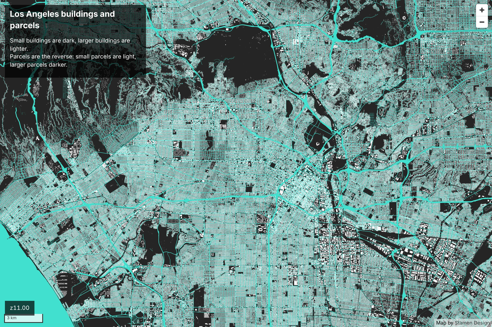
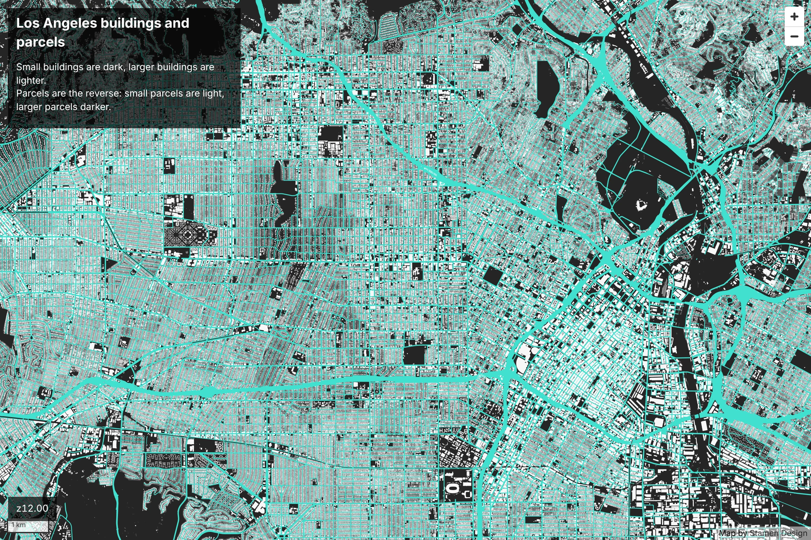
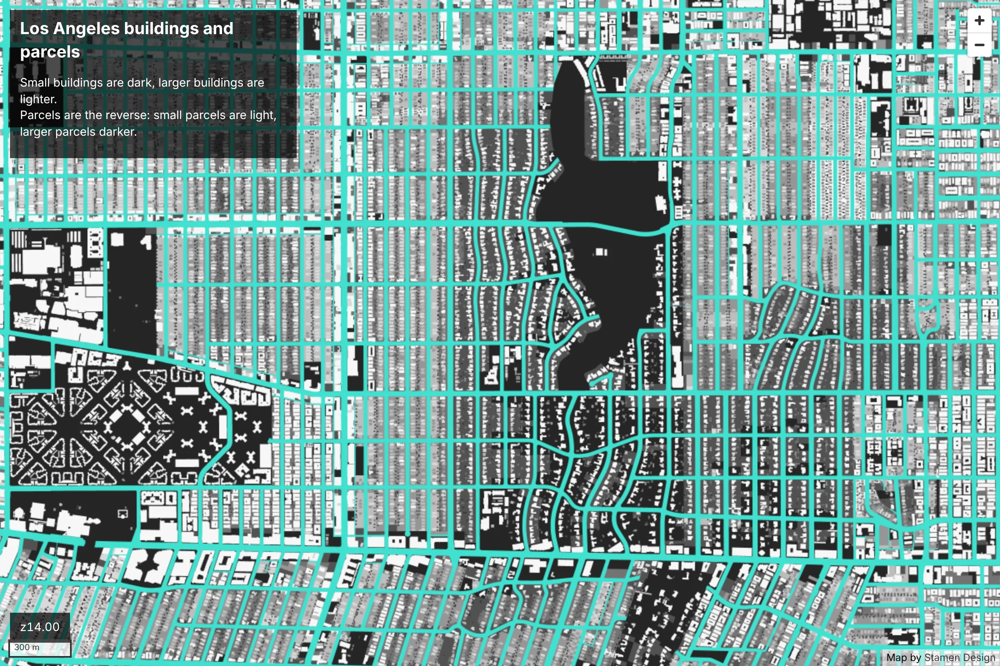
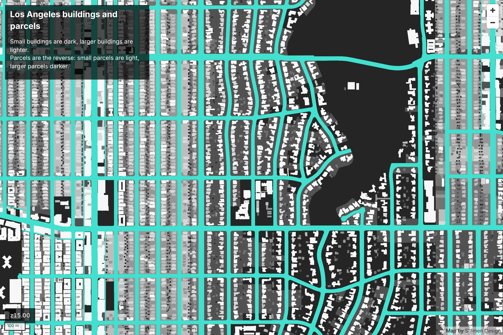
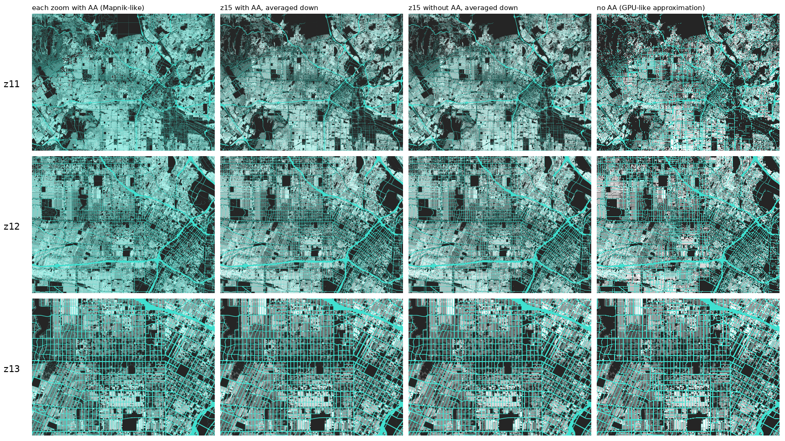
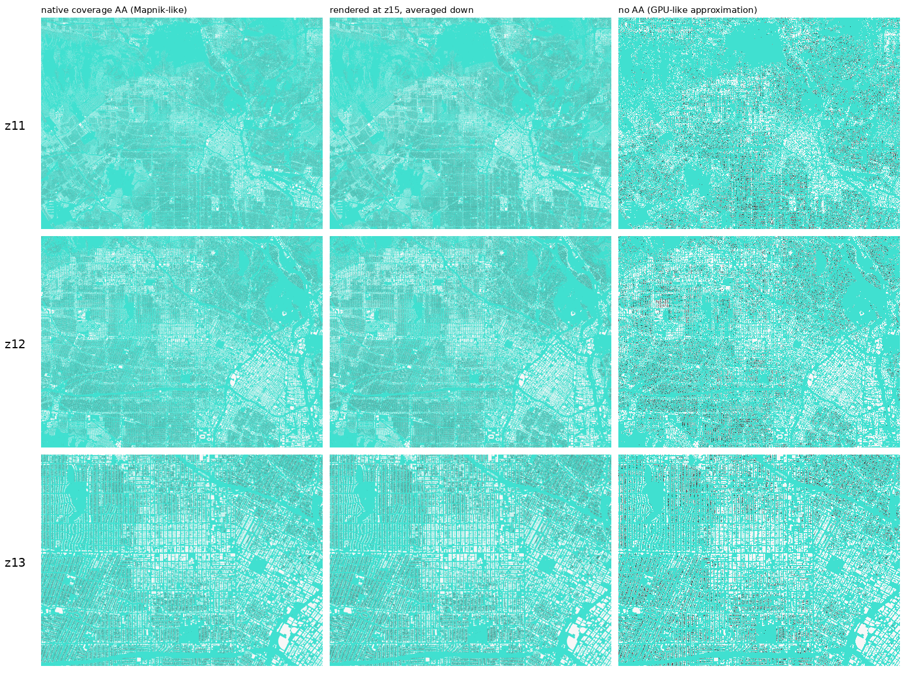

# la.stamen.com modernization prototype

Experiments for rebuilding la.stamen.com on a static stack: MapLibre + PMTiles in cheap object
storage, with **pre-rendered raster tiles at low zoom** (to keep the dense sub-pixel texture the old
Mapnik/CARTO version had) and **vector tiles at high zoom**.

Status: working end to end for a ~65 x 40 km study window over central LA, using 2025 Assessor
parcels (1.46M) and 2020 LARIAC building outlines (2.02M) from LA County's ArcGIS Online services.

| zoom | view |
|---|---|
| z11 (raster) |  |
| z12 (raster) |  |
| z14 (raster; switches to vector at z14.5) |  |
| z15 (vector) |  |

## Pipeline

```sh
pip install skia-python shapely pyarrow numpy pillow pmtiles
python fetch_arcgis.py parcels data/parcels.parquet                 # ~20 min, resumable
python fetch_arcgis.py buildings data/lariac_buildings.parquet      # ~30 min, resumable
python prep.py data/parcels.parquet data/parcels.npz --layer parcels --area-field area_ft2
python prep.py data/lariac_buildings.parquet data/buildings.npz --layer buildings --area-field area_ft2
python experiment.py && python compare.py        # method comparison -> out/sheet_crops.png
python build_raster_tiles.py data/la-raster.pmtiles                 # z9-15, 512 px WebP, ~35 min on 4 cores
python build_overviews.py data/la-raster.pmtiles data/la-raster-ov.pmtiles --from-zoom 11 && mv data/la-raster-ov.pmtiles data/la-raster.pmtiles  # z0-10 by averaging down
python export_geojsonseq.py data/parcels.parquet --layer parcels --area-field area_ft2 > data/parcels.geojsonl
python export_geojsonseq.py data/lariac_buildings.parquet --layer buildings --area-field area_ft2 > data/buildings.geojsonl
tippecanoe -o data/la-vector.pmtiles -Z13 -z16 --drop-rate=1 --no-feature-limit --no-tile-size-limit \
  --no-tiny-polygon-reduction --detect-shared-borders \
  -L parcels:data/parcels.geojsonl -L buildings:data/buildings.geojsonl
# view locally: node web/serve.mjs 8080   -> http://localhost:8080/#12/34.06/-118.3
#   (serves web/ and /tiles/* from data/, with the Range requests PMTiles needs)
# screenshots: cd web && node screenshot.mjs out 14/34.0715/-118.336
```

## Files

- `fetch_arcgis.py` - parcels and LARIAC buildings from LA County's ArcGIS Online feature services
- `fetch_overture_buildings.py` - Overture buildings (earlier stand-in, not used now)
- `web/index.html` - the MapLibre viewer; `web/screenshot.mjs` - Playwright screenshots
- `area.py` - study area (1024x640 px at z11 around Koreatown) and Web Mercator helpers
- `palette.py` - the 2016 7-class Greys palette, the round-number class breaks, and the 2016 breaks for reference
- `compare_breaks.py` - renders candidate class breaks side by side and prints class shares
- `render.py` - Skia renderer: each polygon drawn separately with coverage anti-aliasing, transparent background
- `experiment.py`, `compare.py` - method comparison
- `build_raster_tiles.py` - low-zoom raster PMTiles
- `export_geojsonseq.py` - input for tippecanoe

## Findings

**Rendering method.** Parcels share every edge. Drawing each polygon with its own anti-aliasing
(as Mapnik did) leaks background through every seam: at z11 the window shows 39.5% background
versus 28.5% true non-parcel area, which tints dense neighborhoods turquoise. Rendering without
AA at 8x resolution and box-averaging ("supersampled") gives exactly the true coverage at every
zoom, so only real streets show the background. `build_raster_tiles.py` uses that.



Earlier buildings-only comparison (Overture data):



**Data.** `Shape__Area` (parcels) and `AREA` (buildings) are square feet, within 0.25% of areas
computed from the geometry. 2025 parcels and 2020 buildings still split almost evenly across the
2016 quantile breaks.

**Class breaks.** Replaced the 2016 quantiles with round numbers that read cleanly in a legend
(inclusive upper bounds, sq ft); see `docs/class_breaks_options.png`.

| | breaks | share per class, small to large |
|---|---|---|
| buildings | 400 · 800 · 1,400 · 1,800 · 2,400 · 3,000 | 12 · 18 · 16 · 12 · 17 · 11 · 15 % |
| parcels | 5,000 · 6,000 · 7,000 · 8,000 · 10,000 · 20,000 | 14 · 18 · 17 · 12 · 9 · 14 · 17 % |

Parcel breaks get 1% of slack: LA lots cluster at standard sizes (2-3% of parcels within 0.5% of
exactly 5,000, 6,000 or 7,500 sq ft), and without slack a break at 5,000 would split identical lots
on one block between two grays.

**Sizes for the study window.** Raster z0-15: 3,202 tiles, 189 MB (z0-14 alone: ~870 tiles, 82 MB).
z0-10 are box averages of z11 (`build_overviews.py`): rendered directly, z9-10's 8x8 samples per
pixel land 10-20 m apart, coarser than a house; averaging down keeps the coverage exact.
Vector z13-16: 267 MB.

**Raster display.** MapLibre samples raster textures `LINEAR_MIPMAP_NEAREST`, which snaps to a
half-size mip level once a tile is drawn shrunk past ~1.4x, so the map softened abruptly at fixed
zooms (z13.5 on a 1x screen). The viewers swap in trilinear filtering and size raster tile slots at
`512 / (devicePixelRatio * sqrt 2)` so tiles are always drawn 1-2x shrunk; since each level is a
box-filtered half of the next, the level hand-off is continuous. The z15 level keeps the raster from
being enlarged on 2x screens before the z14.5 switch to vectors.

- The 2008 class breaks still split today's ~2M buildings into seven nearly equal classes.
- Rendering each zoom natively and rendering at z15 then averaging down look nearly identical for
  buildings, which rarely share edges. Parcels share every edge, so that is where the two methods
  should diverge; needs parcel data to test.
- No anti-aliasing (a stand-in for GPU vector rendering) gives black speckle and holes: the effect
  the raster tiles are there to avoid.
- Python + skia-python manages ~19 us/polygon (~40 s per 2M-polygon pass). Fine for a prototype; use
  Rust/tiny-skia for the full county.
